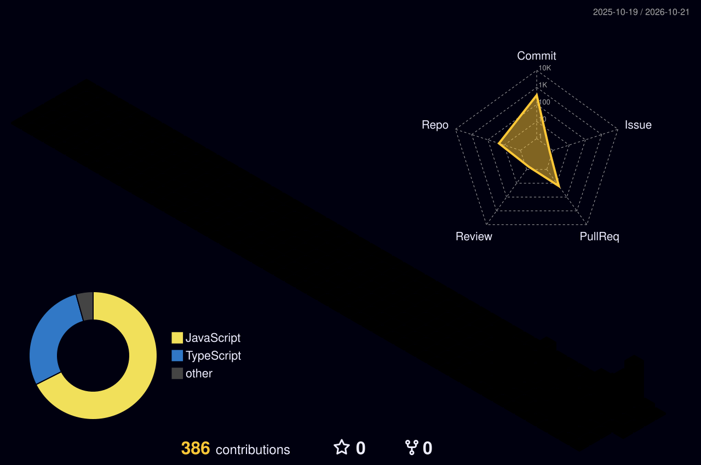

<picture>
  <source media="(prefers-color-scheme: dark)" srcset="assets/header-dark.svg">
  <source media="(prefers-color-scheme: light)" srcset="assets/header-light.svg">
  
</picture>

 

**I turn real problems into working software, with AI agents in the loop and tests as the proof.**

---

## About

I'm **Osarii**, a Computer Engineering student in Costa Rica who has worked the whole path from a fiber splice to a deployed web app.

I've done field telecom installs, on-site IT support and freelance full-stack work. Today I build software with AI agents doing real work (planning, writing, testing and reviewing code) inside guardrails I design, and I stay accountable for what ships.

The role I'm growing into is **Forward Deployed Engineer**: close to the people with the problem, fast from idea to working software, and honest about what is verified and what is not.

## How I build with AI

<picture>
  <source media="(prefers-color-scheme: dark)" srcset="assets/pipeline-dark.svg">
  <source media="(prefers-color-scheme: light)" srcset="assets/pipeline-light.svg">
  
</picture>

- **Multi-agent development.** I split work between coding agents (Claude Code, Codex, Gemini) with explicit contracts: file ownership, interfaces, limits and budgets. Their branches merge without manual rewrites.
- **Verification over trust.** An agent saying "done" isn't evidence. I rely on tests, mutation checks, end-to-end runs (Playwright, Vitest, `node --test`) and a recorded trail of what actually ran.
- **Humans keep the decision.** In clinical and engineering prototypes, deterministic engines are the source of truth. AI explains, and every write needs explicit human confirmation.
- **Automation that touches the real process.** I build n8n workflows (webhooks, branching, responses) wired into React front ends for bookings, invoicing and inventory alerts.

## Selected Work

<table>
<tr>
<td width="50%" valign="top">
01 · DECISION SUPPORT
<h3><a href="https://github.com/Osarii/CDSS">SAMED · CDSS ↗</a></h3>

A clinical decision-support prototype where a deterministic rules engine raises alerts and AI only explains. Missing data is never treated as normal. All data is synthetic.

React 19 · TypeScript · json-rules-engine
</td>
<td width="50%" valign="top">
02 · ENGINEERING PLATFORM
<h3><a href="https://github.com/Osarii/Arch_Tech">ARCH_TECH ↗</a></h3>

A browser-based OpenBIM workspace for real IFC files: inspect, measure, edit, export. It has a multi-role client portal and an AI assistant that needs human confirmation for every write.

React · IFC · n8n webhooks · JSON Server
</td>
</tr>
<tr>
<td width="50%" valign="top">
03 · AUTOMATION
<h3><a href="https://github.com/Osarii/HotelFlow_Automatizacion">HotelFlow ↗</a></h3>

Hotel booking automation: it validates the guest, checks availability, prices the stay, creates the booking and invoice, and logs the event through an n8n workflow.

React · Vite · n8n · Webhooks
</td>
<td width="50%" valign="top">
04 · SECURITY INTERFACES
<h3><a href="https://github.com/Osarii/Cyb3r_Soc">CYB3R_SOC ↗</a></h3>

A responsive security operations interface for simulated threat monitoring, incident workflows and DDoS mitigation.

React · TypeScript · Three.js · Recharts · Playwright
</td>
</tr>
<tr>
<td width="50%" valign="top">
05 · DATA SYSTEMS
<h3><a href="https://github.com/Osarii/enterprise-data-reconciliation">Data Reconciliation ↗</a></h3>

An ERP/CRM CSV reconciliation workflow covering field mapping, data quality, exception review, analytics and reports.

React · TypeScript · Material UI · Vitest
</td>
<td width="50%" valign="top">
06 · INTERACTIVE 3D
<h3><a href="https://github.com/Osarii/BOKAGEDDON">BONKAGEDDON ↗</a></h3>

A 3D survivor-like browser game with physics combat, procedural audio and local scores.

React 19 · React Three Fiber · Rapier · Zustand
</td>
</tr>
</table>

## Toolbox

<b>AI &amp; automation</b> · Claude Code · Codex · Gemini · prompt and agent contracts · n8n · webhooks <b>Quality</b> · Vitest · Playwright · node:test · mutation testing <b>Field &amp; infrastructure</b> · fiber optics (splicing, OTDR) · structured cabling · networking · IT support

## Contribution Skyline

<picture>
  <source media="(prefers-color-scheme: dark)" srcset="profile-3d-contrib/profile-night-rainbow.svg">
  <source media="(prefers-color-scheme: light)" srcset="profile-3d-contrib/profile-green-animate.svg">
  
</picture>

---

SCOPE · BUILD · VERIFY · SHIP 
<a href="https://github.com/Osarii">@Osarii</a> · Costa Rica

